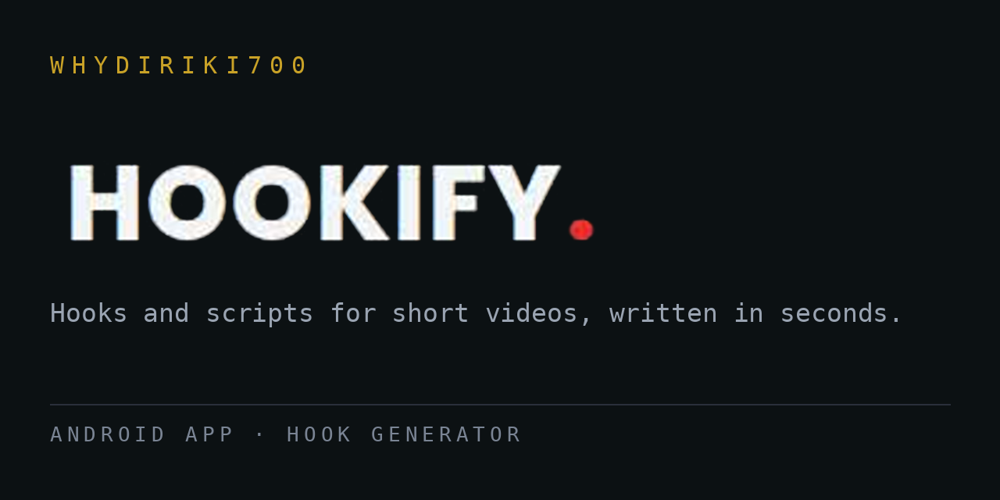

# Hookify

Hookify is an Android app that generates hooks and scripts for short videos. Pick a topic, generate, then copy the result or export it as a file.

## Features

- Hook and script generator for short-form video, with a generator page, results, and in-app history
- Trial mode with 3 free scripts
- Licensed full access with offline tolerance: 72 hours for monthly and yearly licences, 30 days for Lifetime
- Export results to .txt and .docx files

## Brand

The wordmark is white HOOKIFY. with a red dot, on dark #0C1113. The same wordmark is the launcher icon and the intro animation inside the app.

## Tech

- Flutter and Dart
- Android package com.hookify.app, version 3.0.0
- The `server/` folder holds the database schema for the licence service (hookify-schema.sql)

## Repository notes

Signing configuration, keystores, and production licence data are intentionally not stored in this repository.

## License

Proprietary. Copyright (c) 2026 Riki Wahyudi. See [LICENSE](LICENSE).
